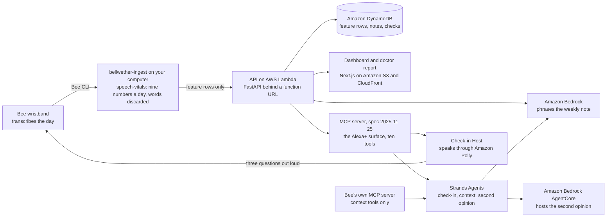

# Bellwether

Bellwether turns the speech your Bee already transcribes into nine numbers a day, learns how you normally speak, and shows you when that changes against your own past. The words never leave your computer.

Built for the Build, Ship, Shape: Amazon Developer Hackathon. Tracks: Bee (primary) and Alexa+ (a self-hosted MCP server and an Agent Skill). Mini challenges: AWS Builder and Open Source.

**Not a diagnosis.** Bellwether is a general wellness tool. It does not diagnose, treat, cure or prevent any disease, and it is not a medical device. Speech changes with sleep, stress, illness, medication and mood. Bellwether describes change over time in one person, lists its reasons, and gives you a page to bring to a clinician.

**Judging this?** [docs/FOR_JUDGES.md](docs/FOR_JUDGES.md) maps every rule and judging criterion to the file, command or link that proves it.

## Live

- Demo video (2:58): https://youtu.be/hcvqqNoXumw
- Site, dashboard and doctor report: https://d1xfuyog8wiuvf.cloudfront.net
- The builder's own Bee check-ins: https://d1xfuyog8wiuvf.cloudfront.net/app/?profile=me-voice
- API: https://bppni6dpuntpbynfydk52gexue0xulzh.lambda-url.us-east-1.on.aws ([interactive docs](https://bppni6dpuntpbynfydk52gexue0xulzh.lambda-url.us-east-1.on.aws/v1/docs), [resilience report](https://bppni6dpuntpbynfydk52gexue0xulzh.lambda-url.us-east-1.on.aws/api/resilience))
- MCP server, the Alexa+ surface: `https://bppni6dpuntpbynfydk52gexue0xulzh.lambda-url.us-east-1.on.aws/mcp` (spec 2025-11-25, Streamable HTTP, ten tools)
- Open-source package: [`speech-vitals` on PyPI](https://pypi.org/project/speech-vitals/)

## What it does

- **Reads your Bee.** `bellwether-ingest` calls the Bee CLI (`bee conversations`, `bee journals`, `bee now`, `bee changed`, `bee todos`) and reads `bee stream --json` and `bee sync` output. One command, `bellwether-ingest mine`, does a wearer's first day end to end.
- **Keeps nine numbers, throws the words away.** `speech-vitals` reduces each day to nine language features (vocabulary variety, sentence length, syntactic depth, pronoun reliance, filled pauses, disfluencies, rare words, idea density, vocabulary size) on your own computer. Only the numbers are sent.
- **Compares you with yourself.** Seven days of warmup build a personal baseline. After that a one-sided CUSUM on a concern-signed composite looks for persistent drift. No model decides a tier; it is arithmetic you can reproduce from the day's numbers.
- **Explains and reports.** A tier (learning, stable, watch, discuss, excluded) with the measures and dates behind it, a weekly note phrased by Amazon Bedrock from the engine's facts only, and a one-page doctor report.
- **Lets a voice assistant take part.** Ten MCP tools let an assistant read your baseline, host tonight's check-in (`start_check_in`, `coaching_note`), and ask for a second opinion (`weigh_the_change`). A Check-in Host speaks the questions through Amazon Polly while the Bee records, then removes its own words by timing.
- **Works without a Bee too.** `bellwether-ingest file` reads Zoom or Teams `.vtt`, Otter `.txt` or `Name: text` transcripts and keeps only your turns.

## Why it matters

Across all dementias the mean time from first symptoms to diagnosis is 3.5 years [1], and in the US Medicare population about 92 percent of expected mild cognitive impairment cases went undiagnosed [2]. Language from people who were still cognitively normal predicted later Alzheimer's onset a mean of 7.6 years ahead [3]. Everyday speech is recorded by a device people already wear, and nobody is measuring it; Bellwether measures it against the person's own past and hands them a page for a visit that already asks the question [9].

## Architecture



Every box is in this repository: `apps/ingest`, `packages/speech-vitals`, `apps/server` (API, MCP server, Bedrock note), `apps/web`, `apps/agent` (Strands agents and the Check-in Host), `apps/agentcore`, `infra` (CDK for Lambda, DynamoDB, S3, CloudFront).

## What is real and what is simulated

- **Real:** the builder's own Bee check-ins on the live site (profile `me-voice`), seven counted days from the device between 2026-10-15 and 2026-10-23, so the baseline is set and every new day is compared with it; the live Bee capture in [docs/BEE_LIVE.md](docs/BEE_LIVE.md); the hosted check-ins run nightly since 2026-10-19, the last two on 2026-10-22 and 2026-10-23 with 289 and 305 words; the Supreme Court and presidential harness runs; the deployed API, MCP server and AgentCore endpoint; the committed second-opinion run in `apps/agent/runs/`.
- **Simulated:** the person whose speech changes on the live site (`alex-drift`) and the quiet twin (`alex-stable`) are synthetic personas written by this project, labelled SIMULATED on every screen and in every response. `sam-first-week` is a simulated first week for the day-by-day replay. The detector comparison runs on those personas and says so in its result file.
- **Replayed:** the dashboard's first-week replay shows a profile as it stood on each evening (`?as_of=`), built from committed fixtures.
- **Stand-in:** the Check-in Host speaks through Amazon Polly in place of Alexa+, using exactly the MCP tools an Alexa+ agent would get.

## Evidence

Every number below is read from a committed file.

| Measured | Result | File |
|---|---|---|
| Restraint on real speech | 349 oral-argument sessions of 8 Supreme Court justices (2019 term), 0 flagged | `harness/scotus/results.json` |
| Sensitivity on the same real sessions | A shift of 1.5 within-person SD caught in 5 of 5 subjects, median 2 sessions; 0.0 SD caught 0 of 5 | `harness/scotus/results.json` |
| The case for an own baseline | On all nine features, between-justice spread is 0.16 to 0.76 of within-justice spread, none above 1 | `harness/scotus/results.json` |
| Real people over years | 652 assessed press conferences of four presidents with no known dementia diagnosis, 18 flagged (2.8 percent); Reagan 39 assessed, 0 flagged | `harness/presidents/results.json` |
| The decision rule against two simpler ones | 0 false alarms and a flag 2 days into the change; 0 of 18 simpler settings beat it on both axes; the quietest simpler rule is 4 days, the fastest costs 1 false alarm | `fixtures/detector-comparison.json` |
| The synthetic personas | Stable twin: 47 consecutive assessed days with zero false alarms. Drift twin: discuss tier since 2026-09-03 | `fixtures/personas/alex-stable/summary.json`, `fixtures/personas/alex-drift/summary.json` |
| Live Bee data | 209 conversations, 24,849 utterances, 16 days with speech, 205,750 words read on the wearer's machine, 0 words written | `docs/BEE_LIVE.md` |
| Hosted check-in | The first live session kept exactly the wearer's 17 answers, 297 words; host-line removal took 0 of 6,645 real utterances | `apps/agent/README.md`, `packages/speech-vitals/speech_vitals/elicitation.py` |
| Second opinion on AgentCore | Referee note passed the gate first time (`gate: ok`, `note_source: referee`), captured 2026-10-19 | `apps/agent/runs/second-opinion-alex-drift.json` |
| Running cost | 19.8 cents per person per month with a nightly spoken check-in, 5.7 cents without, at AWS list prices | `docs/cost.json` |
| MCP conformance, live | 12 of 12 MUST and 7 of 7 SHOULD on the deployed server (`node scripts/mcp-conform.mjs`, run 2026-10-22) | `scripts/mcp-conform.mjs` |
| Accessibility | Lighthouse 100 on accessibility on all three pages | `docs/ACCESSIBILITY.md` |

The harness corpora contain no labelled cognitive change, so none of this is evidence about dementia; it is the measured behaviour of the software on real speech. Full sources and method: [docs/EVIDENCE.md](docs/EVIDENCE.md). Reproduce: `pip install convokit && python harness/scotus/run.py`, `python harness/presidents/run.py`, `python fixtures/compare_detectors.py`.

## Research

1. Orgeta V, et al. Time to Diagnosis in Dementia: A Systematic Review With Meta-Analysis. *Int J Geriatr Psychiatry*. 2025. doi:10.1002/gps.70129, PMC12300619.
2. Mattke S, et al. Expected and diagnosed rates of mild cognitive impairment and dementia in the U.S. Medicare population. *Alzheimer's Research & Therapy*. 2023;15:128. doi:10.1186/s13195-023-01272-z.
3. Eyigoz E, et al. Linguistic markers predict onset of Alzheimer's disease. *EClinicalMedicine*. 2020;28:100583. doi:10.1016/j.eclinm.2020.100583.
4. Kessels RPC. Patients' memory for medical information. *J R Soc Med*. 2003;96(5):219-222. doi:10.1177/014107680309600504.
5. Luz S, et al. Alzheimer's Dementia Recognition through Spontaneous Speech: The ADReSS Challenge. *Interspeech 2020*. arXiv:2004.06833.
6. Berisha V, et al. Tracking discourse complexity preceding Alzheimer's disease diagnosis: Reagan and Bush press conferences. *J Alzheimers Dis*. 2015;45(3):959-963. doi:10.3233/JAD-142763.
7. Beckmann MN. Did Reagan Decline? *J Alzheimers Dis*. 2024;101(4):1261-1266. doi:10.3233/JAD-240294.
8. Barnett JH, et al. Early intervention in Alzheimer's disease: a health economic study of the effects of diagnostic timing. *BMC Neurology*. 2014;14:101. PMC4032565.
9. Cordell CB, et al. Alzheimer's Association recommendations for operationalizing the detection of cognitive impairment during the Medicare Annual Wellness Visit. *Alzheimer's & Dementia*. 2013;9(2):141-150. doi:10.1016/j.jalz.2012.09.011.
10. Alzheimer's Association. 2026 Alzheimer's Disease Facts and Figures. *Alzheimer's & Dementia*. 2026. doi:10.1002/alz.71345.

The feature-by-feature literature (Covington and McFall 2010, Fraser et al. 2016, Ahmed et al. 2013, Snowdon et al. 1996, Konig et al. 2015) is in [packages/speech-vitals/README.md](packages/speech-vitals/README.md) and in code in `speech_vitals/types.py`.

## Run it

```
python -m venv .venv && .venv/Scripts/activate      # or source .venv/bin/activate
pip install -e "packages/speech-vitals[nlp,dev]" -e "apps/engine[dev]" -e "apps/ingest[dev]" -e "apps/server[dev]"
python -m spacy download en_core_web_sm

uvicorn bellwether_server.main:app --port 8789      # API and MCP server on :8789
cd apps/web && npm install && npm run dev           # the site on :3000
```

With a Bee: `npm install -g @beeai/cli`, enable Developer Mode in the Bee app, `bee login`, then:

```
bellwether-ingest firstrun                          # rehearse the whole chain, read only
bellwether-ingest mine --profile <your-name>        # your first day: read the Bee, send nine numbers, open your page
python apps/agent/check_in_host.py --profile <your-name> --count   # the assistant asks, the Bee records, the day is counted
```

Without a Bee: `bellwether-ingest file meetings/*.vtt --speaker "Your Name"`.

Agents (`pip install strands-agents strands-agents-tools mcp`, AWS credentials with Bedrock access):

```
python apps/agent/speech_check_in.py --url https://bppni6dpuntpbynfydk52gexue0xulzh.lambda-url.us-east-1.on.aws/mcp
python apps/agent/second_opinion.py --profile alex-drift
python apps/agent/context_check_in.py --profile alex-drift
```

Deploy your own stack: `cd infra && npm install && npm run deploy` (see [docs/AWS.md](docs/AWS.md)). Deploy the second opinion to AgentCore: see [apps/agentcore/README.md](apps/agentcore/README.md).

On Windows, clone to a short path such as `C:/dev/bellwether`; spaCy's parser does not load from a deep directory (FRICTION_LOG.md entry 8).

## Tests

```
.venv/Scripts/python.exe -m pytest -q packages/speech-vitals apps/engine apps/ingest apps/server apps/agent
```

Run on 2026-10-23: `300 passed`.

| Package | Tests |
|---|---|
| [`packages/speech-vitals`](packages/speech-vitals) | 35 |
| [`apps/engine`](apps/engine) | 69 |
| [`apps/ingest`](apps/ingest) | 86 |
| [`apps/server`](apps/server) | 73 |
| [`apps/agent`](apps/agent) | 37 |

**300 tests.** They include guards that check published numbers against the files that produce them: `apps/engine/tests/test_claims.py` re-derives every persona figure, `test_published_counts.py` counts this table, `apps/server/tests/test_cost.py` recomputes `docs/cost.json`, and `apps/engine/tests/test_scotus_harness.py` pins the Supreme Court result when the corpus is present.

The web app (`apps/web`) has no unit tests; `npx vitest run` reports no test files. It is checked against the deployed site by the Lighthouse runs in `docs/ACCESSIBILITY.md`.

## AWS and tools used

| Tool | What it does here | Where |
|---|---|---|
| Bee CLI | every path Bee data takes in: conversations, journals, todos, changes, stream, sync | `apps/ingest/bellwether_ingest/bee.py` |
| Bee's own MCP server | held beside Bellwether's by the context agent, behind an allowlist of nine context tools | `apps/agent/context_check_in.py` |
| MCP server, spec 2025-11-25, Streamable HTTP | the Alexa+ surface: ten tools, signed sessions, probed live | `apps/server/bellwether_server/mcp.py` |
| Agent Skill | tells an assistant how to use the ten tools and what never to say | `skills/bellwether/SKILL.md` |
| Amazon Bedrock | phrases the weekly note on a three-model Claude ladder with a deterministic template floor; runs every agent | `apps/server/bellwether_server/bedrock.py` |
| Strands Agents | Speech Check-in agent, Context agent, and the second opinion (Advocate, Sceptic, gated Referee) | `apps/agent/speech_check_in.py`, `apps/agent/context_check_in.py`, `apps/agent/second_opinion.py` |
| Amazon Bedrock AgentCore | hosts the second opinion as runtime `bellwethersecond_secondopinion`, verified by live invocation | `apps/agentcore/app/secondopinion/main.py` |
| Amazon Polly | the voice of the Check-in Host | `apps/agent/check_in_host.py` |
| Amazon DynamoDB | one on-demand table of feature rows, notes, checks and metadata | `apps/server/bellwether_server/store.py`, `infra/bin/app.ts` |
| AWS Lambda | the FastAPI app behind a function URL (Python 3.12, Mangum) | `apps/server/bellwether_server/lambda.py`, `infra/bin/app.ts` |
| Amazon S3 and Amazon CloudFront | the static Next.js site | `infra/bin/app.ts` |
| AWS CDK | the whole stack as TypeScript, one `npm run deploy` | `infra/` |

Reasons for each choice, and what was deliberately not used: [docs/AWS.md](docs/AWS.md).

## Privacy

- **On your computer:** the transcript is reduced to nine numbers and a word count inside `speech_vitals.aggregate_day`, and the words are dropped at the day boundary. The Check-in Host's line timings stay in a local `.bellwether-host.json`.
- **What leaves:** a date, nine features and a word count per day. The API's `validate_day` drops any field the schema does not know; `apps/server/tests/test_server.py` posts a row carrying a `transcript` field and checks it never lands.
- **What is stored:** feature rows (`DAY#`), notes you choose to add (`ANN#`), spoken-check scores (`CHECK#`) and metadata such as a profile's claim-key hash (`META#`), under `PROFILE#{id}` in one DynamoDB table. Reads are open; writes to a claimed profile need the key (`X-Bellwether-Key`), stored as SHA-256 and compared in constant time.
- **What the models see:** Amazon Bedrock receives the engine's facts text, never speech. The context agent's allowlist withholds every Bee tool that returns verbatim speech (`apps/agent/tests/test_allowlist.py`). The AgentCore runtime reaches a profile only through the public MCP tools.
- **Shown live:** the site's privacy check sends a transcript full of names to a fresh in-memory store and searches what was kept (`apps/server/bellwether_server/privacy_check.py`).

## Documentation

[FOR_JUDGES.md](docs/FOR_JUDGES.md) · [SUBMISSION.md](docs/SUBMISSION.md) · [EVIDENCE.md](docs/EVIDENCE.md) · [PILOT.md](docs/PILOT.md) · [DESIGN.md](docs/DESIGN.md) · [AWS.md](docs/AWS.md) · [ACCESSIBILITY.md](docs/ACCESSIBILITY.md) · [BEE_LIVE.md](docs/BEE_LIVE.md) · [VIDEO_SCRIPT.md](docs/VIDEO_SCRIPT.md) · [FEATURE_REQUESTS.md](docs/FEATURE_REQUESTS.md) · twenty entries in [FRICTION_LOG.md](FRICTION_LOG.md) · [PRODUCT_FEEDBACK.md](PRODUCT_FEEDBACK.md)

## Licence

MIT. See [LICENSE](LICENSE).
